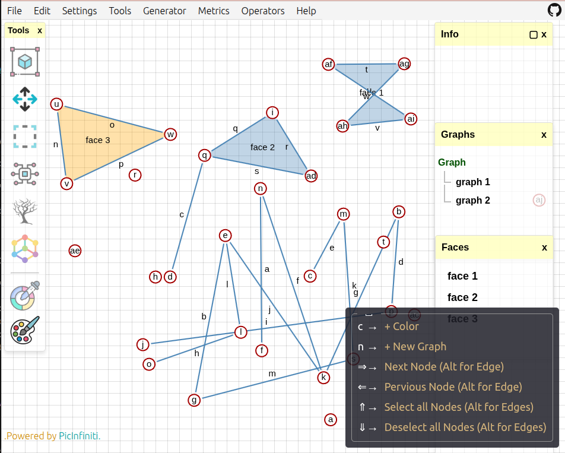
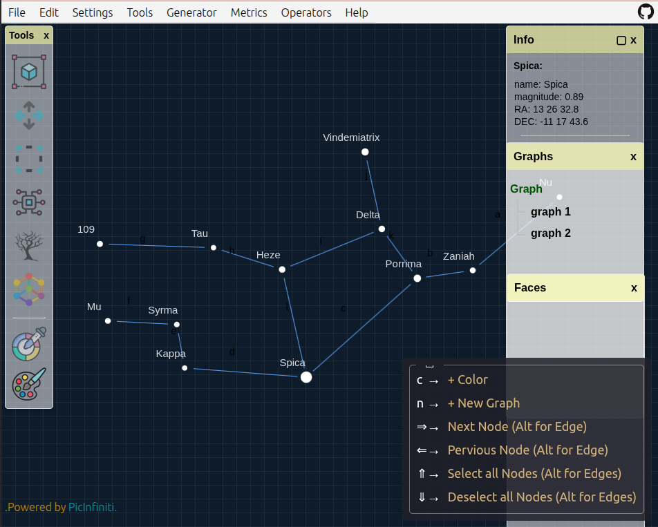

# 🌌 Graph Studio


**Graph Studio** is a powerful, browser-based platform for building, visualizing, and analyzing graphs. Built using **D3.js (Canvas)** and **Graphology.js**, it supports complex graph modeling with a sleek interface and deep analytical tools — now reengineered with multi-layer canvas rendering for better performance and richer interaction.

👉 [Live Demo](https://graph.picinfiniti.net/)

---

## 🚀 What's New in v1.9.11

- 🎯 **Canvas Layer Overhaul** — Uses 4 separate canvas layers (nodes, edges, faces, interaction) for smoother rendering and control.
- 🔺 **Face Support** — Define and color enclosed cycles using the new _Face_ tool (`Ctrl+F`). Each face is editable and visible in the _Faces Panel_.
- 🌐 **Subgraphs** — Select any group of nodes to create reusable, editable subgraphs. View/edit from the _Graphs Panel_.
- 📝 **Full Metadata Editing** — Add/edit labels, weights, and descriptions for nodes, edges, faces, and subgraphs.
- 📁 **Dedicated Panels** — Manage everything from separate _Info_, _Graphs_, and _Faces_ panels. Toggle them from `Settings → View`.
- 🧠 **Shortcut Chord System** — Combine key sequences like `Space → c → c` for quick tool access (see guide below).
- 📀 **IndexedDB Storage** — Workflow state and history now saved in-browser using **Dexie.js** (IndexedDB). Works reliably even with large graphs.
- 💾 **Autosave** — Your graph state and history are saved in-browser between sessions. Recover work even after tab closes.
- ⚙️ **Performance Mode** — Optional mode disables animations for smoother handling of massive graphs.
- 📦 **Export Includes History** — Save full state (graph + edit history) in JSON exports.
- 🛠️ **New Operators Menu** — Control layout (flip, rotate, force atlas), convert graph types, generate subgraphs, and more.

---

## ✨ Features Overview

### 📁 File Menu

- 🆕 New Graph (Mixed / Directed / Undirected)
- 📂 Import JSON graphs
- 💾 Export Graph (JSON with history)
- 🖼️ Export PNG snapshot
- 🌙 Sky Night Theme
- 🔄 Reload workspace

### ✏️ Edit Menu

- ➕ Add Edge / Directed Edge / Face (`Ctrl+F`)
- 🗑️ Delete, Copy, Cut, Paste
- 🎨 Assign Color (RGBA, label, edge, fill, stroke)
- 🔠 Rename, Add Weight, Add Description
- 🔄 Undo / Redo

### ⚙️ Settings Menu

- 📐 Graph: label toggles, size sliders (vertex, edge, label, stroke)
- 🌌 View: toggle Info, Tools, Graphs, and Faces panels, Key Chord mode
- 🚀 Performance Mode: disables animations for large graphs
- 🕰️ History Options: limit memory size, disable autosave, clear saved data

### 🧰 Tools Menu

- 🔍 Zoom, Panning (`Ctrl`), Selecting (`Shift`), Component Selector (`Alt`)
- 🌳 Tree & Force Simulation tools
- 🎛️ **Force Edge Toggle** – Enable/disable edge influence in force layout
- 🎨 Quick Color Picker (`Space → c → c`)

### ⚙️ Generator Menu

Create graphs from built-in templates:

- **Classic:** Empty, Kₙ, Kₙ,ₙ, Pₙ, Cₙ, Lₙ
- **Community:** Caveman, Connected Caveman
- **Random:** Clusters, Erdős-Rényi, Girvan-Newman
- **Famous:** Krackhardt Kite, Karate Club, Florentine Families
- **Zodiac:** 13 real constellations with RA/DEC and magnitude

### 📊 Metrics Menu

- **Basic:** Degree Sequence, Density, Components, Diameter
- **Centrality:** Betweenness, Closeness, PageRank, Eigenvector
- **Layout Quality:** Edge Uniformity, Stress, Neighborhood Preservation
- **Extras:** Disparity, Simmelian Strength
- 🔍 Explore Neighbors, Shortest Path, Info Panels

### ♻️ Operators Menu (NEW)

- Layout: Organize, Rotate, Flip, Random, Force Atlas
- Convert: Graph ⇌ Digraph, Weighted ⇌ Unweighted
- Subgraph creation & selection
- Reverse direction, Complete Graph

### ❓ Help Menu

- 💡 Shortcut Guide, Mouse Commands, Usage Instructions, About (v1.9.3)

---

## 🖐 Touch & Keyboard Controls

### Touch

- Double-tap canvas: Add node
- Tap (Select Tool): Select nodes or edges
- Drag: Move node (with visual update after drop in Performance mode)

### Keyboard Shortcut Guide

#### ⌨️ Shortcut Notation

- `Alt+a` → Press **a** while holding **Alt**
- `Alt-a` → **Two different shortcuts**: `Alt` and `Alt + a`
- `Space cc` → Press **Space**, then **c**, then **c** (in sequence)

Chord keys show hints as you type. Examples:

- `Space → n → d`: Start a new **Directed** graph
- `Alt+e`: Add Edge (in order)
- `Ctrl+f`: Add Face (requires 3+ nodes forming a cycle)

---

## 💡 Tips for Large Graphs

- ⚙️ Enable **Performance Mode** (Settings → Performance)
  - Disables force animations
  - Defers redraws until after interactions
- 📀 Your workflow and history now persist via **IndexedDB** — no more size limitations
- ❌ If the app crashes or won’t load:
  - Go to **Settings → History → Clear History**, then reload
  - Always **export your graph** if you're doing important worke.
- 🧭 Only visible regions are rendered, dramatically improving frame rates on graphs with thousands of nodes.

---

## 📸 Screenshots

### Graph Studio UI



### Night Sky Mode



---

## 🛠 Development and deployment

Graph Studio uses the [PicInfiniti Vite template](https://github.com/PicInfiniti/template-vite)
(tooling adopted from commit `586f3e9`), with Vite 8, vanilla JavaScript, and
indented Sass. The graph editor, local autosave, and graph dependencies are retained.

Use Node.js 24 LTS (see `.nvmrc`), or Node.js 22 starting at 22.13:

```bash
git clone https://github.com/PicInfiniti/app-graph.git
cd app-graph
nvm use
npm ci
npm run dev
```

| Command                                   | Purpose                                                               |
| ----------------------------------------- | --------------------------------------------------------------------- |
| `npm run dev`                             | Start the development server                                          |
| `npm run build`                           | Build the app into `dist/`                                            |
| `npm run preview`                         | Preview the production build locally                                  |
| `npm run lint` / `npm run lint:fix`       | Check JavaScript / apply automatic fixes                              |
| `npm run format` / `npm run format:check` | Format files / check formatting                                       |
| `npm test`                                | Run deployment integration tests against temporary local repositories |
| `npm run check`                           | Run lint, formatting, tests, and the production build                 |
| `npm run deploy`                          | Run all checks, build, and publish to the deployment branch           |

GitHub Actions runs `npm ci` and `npm run check` on pushes and pull requests.
Prettier skips indented `.sass` files; EditorConfig provides their whitespace defaults.
The `@` import alias resolves to `src/`. Additional HTML files under `pages/`
are automatically included in production builds.

### Configuration

Copy `.env.example` to `.env` or `.env.production` when configuration is needed.
Use `BASE_PATH=/` for the existing custom domain, or `BASE_PATH=/app-graph/`
for GitHub project Pages. Use `%BASE_URL%` in HTML public asset URLs and
`import.meta.env.BASE_URL` when building public asset URLs in JavaScript.
Only `VITE_*` variables are exposed to browser code; never put secrets in them.
Restart the development server after changing environment files.

Development and preview servers retain the cross-origin isolation headers used
by Graph Studio's worker setup. Configure matching headers on your production
host if your deployment requires cross-origin isolation.

### Deployment

```bash
npm run deploy
```

The template's Node/Git deployment script replaces `gh-pages`. It runs checks,
publishes only `dist/`, adds `.nojekyll`, and preserves `public/CNAME` (Vite
copies public files automatically). It keeps deployment history, uses no force
push, and leaves the source branch and working tree intact. Identical output
does not create another deployment commit.

The defaults are `DEPLOY_REMOTE=origin` and `DEPLOY_BRANCH=gh-pages`; override
them through `.env.production` or environment variables. Configure Git
`user.name`, `user.email`, and authentication before deployment. In GitHub's
**Settings → Pages**, choose **Deploy from a branch**, select **gh-pages**, and
use **/ (root)**. The CI workflow checks changes without deploying them.

Or use the hosted app at [graph.picinfiniti.net](https://graph.picinfiniti.net/).

---

## 🧪 Built With

- [D3.js (Canvas)](https://d3js.org/)
- [Graphology.js](https://graphology.github.io/)
- JavaScript (ES6+), HTML5, CSS3

---

## 📚 Citation

If this tool assists your academic work, please cite:

```bibtex
@misc{graphstudio2025,
  author       = {PicInfiniti},
  title        = {Graph Studio: An Interactive Tool for Graph Visualization and Analysis},
  year         = {2025},
  howpublished = {\url{https://graph.picinfiniti.net}},
}
```

---

## 📄 License

Copyright (c) 2025 PicInfiniti.

Licensed under the [Apache License, Version 2.0](./LICENSE).

---

## 🤝 Contributing

Suggestions, issues, and PRs are welcome! Check the issues tab or submit a pull request to improve Graph Studio.

---

## 🌠 Author

Created by [**PicInfiniti**](https://github.com/PicInfiniti) — fueled by curiosity and a love for the stars.

Check the `About` section in-app for version info and more.
